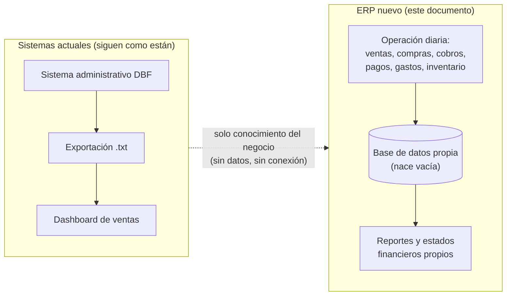
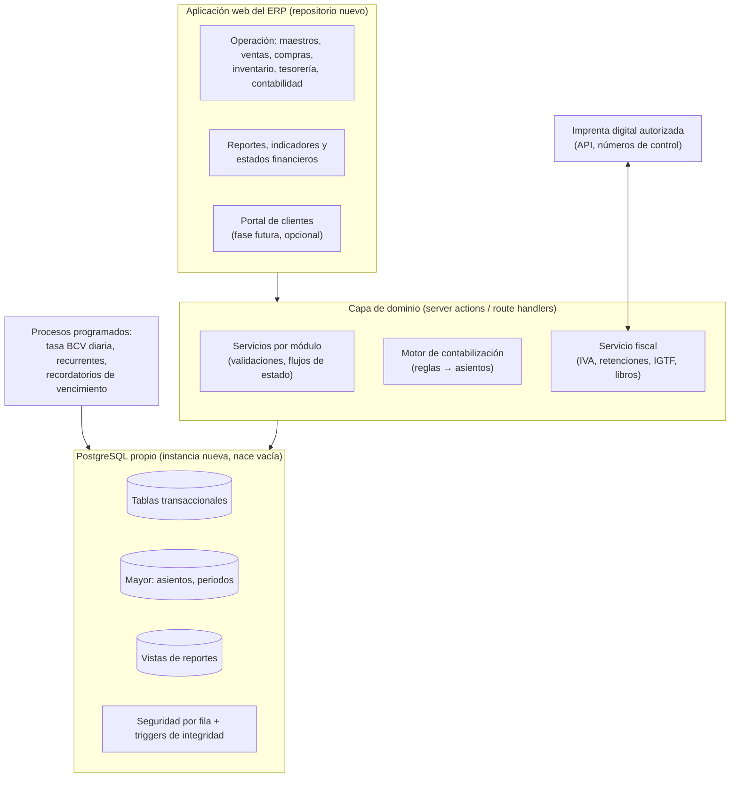

# Especificación Funcional y Técnica: ERP Distribuciones Hanei Motors

> **Propósito.** Este documento define un ERP **nuevo e independiente** para Distribuciones Hanei Motors: maestros, ventas, compras, inventario, comisiones, gastos, tesorería, contabilidad, fiscal y estados financieros. Está pensado para que un equipo, o un agente de desarrollo, lo construya por fases.
>
> **Proyecto separado.** El ERP tiene **su propio repositorio, su propia base de datos, sus propios usuarios y su propio despliegue**. No comparte código, tablas, credenciales ni procesos con el dashboard de ventas actual, con su base PostgreSQL/Supabase, con el sistema DBF ni con los archivos `.txt` exportados. **No hay migración de datos:** la base de datos arranca vacía y se llena con la operación diaria (ventas, compras, cobros, pagos, gastos) desde la fecha de arranque (§14).
>
> **Documentos relacionados.** Reportes e indicadores (réplica del dashboard) en [`spec_reportes.md`](spec_reportes.md); reglas de desarrollo en [`../AGENTS.md`](../AGENTS.md); registro de decisiones de la §16 en [`decisiones.md`](decisiones.md).
>
> **Cómo usarlo.** Construye en el orden de la §13 (Hoja de ruta). Cada módulo trae entidades, procesos, reglas de negocio, asientos contables y criterios de aceptación. Las tasas fiscales y los porcentajes **nunca se escriben en el código**: van en tablas de parámetros (§4.2). Usa la versión estable más reciente del framework elegido y consulta su documentación oficial antes de escribir código.
>
> **Aviso fiscal.** La normativa venezolana cambia por providencia administrativa. Las reglas de la §11 reflejan lo investigado a septiembre de 2026 y **deben validarse con el contador y el asesor tributario** antes de salir a producción.

---

## Índice

1. [Punto de partida: qué se toma de la operación actual](#1-punto-de-partida-qué-se-toma-de-la-operación-actual)
2. [Lecciones de la auditoría convertidas en requisitos](#2-lecciones-de-la-auditoría-convertidas-en-requisitos)
3. [Principios de diseño (mejores prácticas)](#3-principios-de-diseño-mejores-prácticas)
4. [Arquitectura y módulos transversales](#4-arquitectura-y-módulos-transversales)
5. [Datos maestros](#5-datos-maestros)
6. [Ventas: del pedido al cobro (Order-to-Cash)](#6-ventas-del-pedido-al-cobro-order-to-cash)
7. [Compras: de la orden al pago (Procure-to-Pay)](#7-compras-de-la-orden-al-pago-procure-to-pay)
8. [Inventario y costos](#8-inventario-y-costos)
9. [Comisiones de venta](#9-comisiones-de-venta)
10. [Gastos, tesorería y bancos](#10-gastos-tesorería-y-bancos)
11. [Módulo fiscal Venezuela](#11-módulo-fiscal-venezuela)
12. [Contabilidad general y estados financieros](#12-contabilidad-general-y-estados-financieros)
13. [Hoja de ruta por fases](#13-hoja-de-ruta-por-fases)
14. [Arranque operativo (sin migración)](#14-arranque-operativo-sin-migración)
15. [Requisitos no funcionales](#15-requisitos-no-funcionales)
16. [Decisiones abiertas](#16-decisiones-abiertas)
17. [Fuentes](#17-fuentes)

---

## 1. Punto de partida: qué se toma de la operación actual

### 1.1 Separación total



- **No se lee ni se escribe** nada de los sistemas actuales: ni el DBF, ni los `.txt`, ni la base PostgreSQL/Supabase del dashboard.
- **No se reutilizan tablas, usuarios ni lógica de datos** del dashboard. El ERP define su propio modelo desde cero, con las reglas de este documento.
- **Sí se replica su presentación:** el ERP muestra la información con los mismos módulos, pantallas e indicadores del dashboard ([spec_reportes.md](spec_reportes.md)), y sus componentes visuales pueden copiarse y adaptarse.
- Lo único que se toma de la operación actual es **conocimiento**: cómo trabaja el negocio (§1.2 y §1.3) y los errores de datos que no deben repetirse (§2).
- El dashboard actual puede seguir funcionando para consultar el histórico previo al arranque. Los dos sistemas no se conectan.

### 1.2 Procesos del negocio que el ERP debe cubrir

Este inventario sale de analizar la operación que hoy registra el sistema DBF. Sirve para no olvidar ningún proceso, **no** como mapa de migración.

| Proceso del negocio | Módulo del ERP | Aprendizaje de la operación actual |
|---|---|---|
| Clientes | Maestros (§5.1) | Hoy un cliente "inactivo" se marca asignándole el vendedor `00`, y algunos RIF están incompletos. El ERP necesita un estado propio y un RIF validado |
| Proveedores | Maestros (§5.1) | Una misma empresa puede ser cliente y proveedor: se modela como un solo tercero por RIF |
| Vendedores | Maestros (§5.2) | Conviven vendedores reales con códigos administrativos y de "casa". El ERP necesita un tipo de vendedor explícito |
| Productos, grupos (modelo de vehículo) y marcas | Maestros (§5.3) | Tres listas de precio (A, B, D). El costo no debe salir de una lista de precios |
| Referencias cruzadas de repuestos | Maestros (§5.3) | Clave para buscar equivalencias entre fabricantes |
| Almacenes | Maestros (§5.3) | Hay almacenes comerciales (venta) y otros (depósito, tránsito) |
| Pedidos, notas de entrega y facturas | Ventas (§6) | Las anulaciones deben quedar explícitas y los montos guardados al emitir |
| Devoluciones y notas de crédito | Ventas (§6) | Cada NC debe guardar su monto y referenciar la factura de origen |
| Cobranzas, descuento por pronto pago y retenciones | CxC (§6.3) | El descuento por pronto pago es fuerte (10 % a 25 %, el más común 20 %) y se aplica con nota de crédito |
| Pagos a proveedores | CxP (§7.3) | Deben ir en un libro separado de los cobros de clientes |
| Órdenes de compra, tránsito, recepciones e importaciones | Compras (§7) | La mercancía en tránsito y la pendiente de producción deben controlarse por cantidad pendiente |
| Movimientos de inventario | Inventario (§8) | Entradas, salidas, devoluciones, transferencias y aperturas |
| Bancos y cuentas en divisas | Tesorería (§10) | Cobros en bancos nacionales, cuentas en el exterior, custodia y USDT |
| Metas de venta | Maestros (§5.4) y comisiones (§9) | Deben ser datos cargados y aprobados, nunca valores supuestos |

### 1.3 Contexto del negocio que el ERP debe respetar

- **Rubro:** distribución de repuestos automotrices (Hyundai, Kia y otros), con catálogo organizado por modelo de vehículo (grupo) y marca.
- **Sedes:** Barquisimeto y Caracas, cada una con sus almacenes, vendedores y series de numeración. El ERP las modela como `sucursal`.
- **Dos monedas en la operación diaria:** se vende y se cobra en USD y en Bs, con cobros en bancos nacionales, cuentas en el exterior, efectivo y USDT.
- **Condiciones comerciales:** tres niveles de precio (A, B y D), descuento por pronto pago mediante nota de crédito y crédito típico a 30 días.
- **Importaciones:** compras internacionales con seguimiento de embarque (BL, naviera, ETA) y reparto de gastos de nacionalización al costo.
- **Clientes que hacen pedidos a distancia** y envían comprobantes de pago. Un portal de clientes puede ser una fase futura del propio ERP (§13).

---

## 2. Lecciones de la auditoría convertidas en requisitos

La auditoría del dashboard actual (septiembre de 2026) encontró errores que no daban ninguna señal y que venían de **datos mal modelados en el sistema de origen**. El ERP no toma esos datos, pero sí la lección: cada error se convierte aquí en un requisito de diseño:

| # | Problema encontrado | Requisito del ERP |
|---|---|---|
| L1 | No existe marca de anulación: las facturas anuladas se contaban como ventas | **R1.** Todo documento tiene `estado` explícito (`borrador` → `emitido` → `anulado`) con motivo, usuario y fecha de anulación. Nunca se borra un documento emitido |
| L2 | El mismo cliente aparece como `631` y como `00000631`, y el vendedor como `2` y como `02` | **R2.** Claves internas `uuid` con llaves foráneas. El código visible es único, con formato validado (`CHECK`) y nunca se reescribe |
| L3 | Fechas en `YYYYMMDD` y `D/M/YYYY` en archivos distintos | **R3.** Tipo `date`/`timestamptz` en base de datos. Prohibido guardar fechas como texto |
| L4 | La moneda se deducía del formato del número de documento (numérico = Bs) | **R4.** Cada documento guarda `moneda`, `tasa` y montos en la moneda original, en VES y en USD (§3.4) |
| L5 | Pagos a proveedores mezclados con cobros de clientes | **R5.** Libros auxiliares separados (CxC y CxP), con `tercero` tipado por rol |
| L6 | Tasas distintas para el mismo día entre archivos (702 contra ~330 el 07-01-2026) | **R6.** Una sola tabla `tasa_cambio` por fecha y fuente. Cada documento copia la tasa que usó y queda congelada |
| L7 | Exportaciones solapadas: un mismo movimiento aparecía dos veces | **R7.** Una sola base de datos transaccional donde cada operación se registra una vez. Los reportes leen vistas, no archivos exportados |
| L8 | Metas en `.txt` y metas fijas en el código ($15.000 por vendedor) | **R8.** Metas en tablas, con versión y responsable. Si no hay meta, se muestra "sin meta" |
| L9 | Datos simulados que se mostraban como reales | **R9.** Prohibido mostrar datos de relleno. Ante error se muestra un estado de error |
| L10 | Monto de devolución en 0; columnas con otro nombre (`penddesp`) | **R10.** Los montos se calculan y guardan al emitir el documento. Los esquemas se validan en la importación |
| L11 | Sin autenticación en ninguna ruta; los datos personales de clientes eran públicos | **R11.** Autenticación obligatoria, control de acceso por roles y seguridad a nivel de fila (§4.3) |
| L12 | Clientes inactivos definidos por "vendedor = 00" | **R12.** `estado` del cliente (`activo`, `inactivo`, `bloqueado`) independiente del vendedor |

---

## 3. Principios de diseño (mejores prácticas)

### 3.1 Fuente única de verdad y documentos antes que asientos
- Cada hecho económico nace como un **documento de negocio** (factura, cobro, recepción, gasto). El **asiento contable se genera automáticamente** al emitirlo, a partir de reglas configurables (§12.3).
- Los usuarios operativos no escriben asientos. Los asientos manuales quedan para Contabilidad (ajustes, provisiones, cierres) y requieren aprobación: se registran como borrador, en una sola moneda convertida a VES y USD con la tasa BCV de su fecha, y se contabilizan (reciben número) cuando los aprueba un usuario con el rol Jefe de contabilidad distinto de quien los registró. La base de datos rechaza la contabilización sin esa aprobación.

### 3.2 Partida doble e inmutabilidad
- Todo asiento cuadra: suma del debe = suma del haber. Lo garantiza la **base de datos**, no solo la aplicación.
- **Un asiento contabilizado no se edita ni se borra.** Se corrige con un asiento de reverso dentro de un periodo abierto. Así el rastro de auditoría queda completo y los balances históricos se pueden reproducir.
- Cada periodo contable tiene uno de tres estados: `abierto` (acepta todo), `cerrado` (solo reversos y ajustes autorizados) o `bloqueado` (inmutable tras la auditoría o la declaración). El bloqueo se aplica con un *trigger* de base de datos.

### 3.3 Numeración y trazabilidad
- Numeración **correlativa, sin huecos y por serie** (tipo de documento + sucursal), asignada dentro de la transacción con bloqueo de fila. Un documento anulado conserva su número.
- Cadena de documentos enlazada: cotización → pedido → nota de entrega → factura → nota de crédito. Orden de compra → recepción → factura de compra → pago. Desde cualquier línea del mayor se llega al documento que la originó y viceversa.
- Registro de auditoría de toda creación, cambio de estado, aprobación y anulación: quién, cuándo, desde qué IP y el valor anterior y el nuevo.

### 3.4 Multimoneda (VES legal, USD de gestión)
- **Moneda funcional legal: bolívar (VES).** Los libros legales y las declaraciones se llevan en VES según VEN-NIF.
- **Moneda de gestión: USD.** El negocio fija precios, metas y comisiones en USD.
- Cada documento y cada línea de asiento guarda **tres importes**: moneda original, VES (a la tasa del documento) y USD (a la misma tasa). La tasa se copia al documento al emitirlo y **no cambia después**.
- Las diferencias de tasa entre la factura y su cobro o pago se registran como **diferencial cambiario** en cuentas separadas de ganancia y de pérdida, que se muestran como partida aparte en el estado de resultados.
- La tasa oficial BCV se carga a diario por un proceso automático, con histórico completo. Si se usa una tasa paralela para análisis de gestión (por ejemplo, en el costeo de importaciones), va como otra **fuente** en la misma tabla, y **nunca** para registros legales.

### 3.5 Parametrización fiscal
- Alícuotas de IVA, porcentajes de retención, IGTF, valor de la Unidad Tributaria, tabla del Decreto 1.808 y formatos de comprobante: todo vive en tablas con **vigencia por fecha** (`vigente_desde`, `vigente_hasta`). Un cambio de normativa se resuelve con una fila nueva, sin tocar el código.

### 3.6 Segregación de funciones y control interno
- Quien crea un proveedor no aprueba sus pagos. Quien emite facturas no aplica cobros. Quien registra asientos manuales no los aprueba.
- Tolerancias y límites configurables: límite de crédito, descuento máximo por rol y tolerancia de conciliación en compras (p. ej. 2 %).

### 3.7 Reportes: la misma información que el dashboard, con datos propios
- El ERP **muestra la información igual que el dashboard de ventas desarrollado anteriormente**: los mismos módulos (Inicio, Clientes, Productos, Vendedores, Cobranzas, Devoluciones, Inventario y Metas), pestañas, indicadores, gráficos, tablas, filtros y exportaciones. Todo se detalla pantalla por pantalla en **[spec_reportes.md](spec_reportes.md)**.
- Los datos salen de **vistas SQL** de la base del ERP. No hay conexión con el dashboard, su base de datos ni los `.txt`.
- Las fórmulas son las del dashboard **con las correcciones de la auditoría** (spec_reportes §11).
- Los indicadores muestran información desde la fecha de arranque. Las comparaciones interanuales estarán disponibles cuando se acumulen 12 meses de operación.

---

## 4. Arquitectura y módulos transversales

### 4.1 Arquitectura propuesta



- **Proyecto nuevo e independiente:** repositorio, base de datos, usuarios, credenciales y despliegue propios. Ningún proceso lee ni escribe en los sistemas actuales (dashboard, Supabase, DBF, `.txt`).
- **Monolito modular:** una sola aplicación organizada por módulos (maestros, ventas, compras, inventario, tesorería, contabilidad, fiscal, reportes), más fácil de mantener que microservicios para el tamaño de la empresa.
- **Stack sugerido:** aplicación web en TypeScript (por ejemplo Next.js, en su versión estable más reciente) y **PostgreSQL** en una instancia nueva, administrada o propia. Las reglas de integridad (cuadre del asiento, periodo cerrado, numeración, montos no negativos) van en **restricciones y triggers**, además de la validación en la aplicación.
- **Migraciones de esquema versionadas** (herramienta de migraciones del stack) desde el primer día: la base de datos se crea solo con scripts del repositorio, nunca a mano.
- Todas las escrituras de un documento (documento, líneas, movimientos de inventario, asiento y partidas abiertas) ocurren en **una sola transacción**.
- Operaciones **idempotentes**: contabilizar dos veces el mismo documento no duplica el asiento (restricción única `(origen_tipo, origen_id)`).

### 4.2 Configuración general
| Entidad | Contenido |
|---|---|
| `empresa` | RIF, razón social, domicilio fiscal, si es contribuyente especial, si es agente de retención de IVA, ISLR o IGTF |
| `sucursal` | Barquisimeto, Caracas…; series de numeración propias |
| `moneda`, `tasa_cambio` | VES, USD (y EUR, USDT si se aceptan); tasa diaria por fuente |
| `parametro_fiscal` | Alícuotas, porcentajes y UT con vigencia (§11) |
| `numerador` | Serie, tipo de documento, sucursal, próximo número, prefijo |
| `condicion_pago` | Contado, 15, 30 o 45 días; descuento por pronto pago asociado |
| `instrumento_pago` | Transferencia en Bs, pago móvil, efectivo USD, Zelle, USDT, punto de venta, cheque; indica si genera IGTF |
| `adjunto` | Archivos de soporte (comprobantes de pago, facturas de proveedor, soportes de gastos): ruta en el almacenamiento de archivos, tipo, tamaño, hash, usuario y fecha. Se enlaza a cualquier documento |

### 4.3 Seguridad, roles y auditoría
- **Usuarios propios del ERP** (tabla `usuario`), con **autenticación** obligatoria en todas las rutas, incluidas las rutas API.
- **Límite de intentos de inicio de sesión:** 5 intentos fallidos con un mismo correo en 15 minutos, o 30 desde una misma dirección IP, bloquean el acceso hasta que venza la ventana. El bloqueo aplica igual a correos inexistentes (no revela qué correos están registrados), un acceso correcto reinicia el contador del correo y cada bloqueo de un usuario queda en `audit_log`. La tabla `intento_fallido` guarda solo el hash del correo o de la IP.
- **Roles base:** Administrador, Gerencia, Ventas (vendedor), Supervisor de ventas, Facturación, Cobranzas, Compras, Almacén, Tesorería, Contabilidad, Jefe de contabilidad (aprueba asientos manuales), Auditor (solo lectura) y, si se construye el portal, Cliente.
- **Seguridad por fila:** un vendedor ve solo su cartera, un cliente del portal solo sus documentos, y el almacén solo los almacenes que tiene asignados (`usuario_almacen`).
- **Matriz de segregación de funciones (mínima):**

| Acción | Crea | Aprueba | Nunca la misma persona que… |
|---|---|---|---|
| Alta o cambio de proveedor y de sus cuentas bancarias | Compras | Gerencia | …aprueba pagos |
| Orden de compra | Compras | Gerencia (según monto) | …recibe la mercancía |
| Pago a proveedor | Tesorería | Gerencia | …crea el proveedor |
| Nota de crédito comercial | Ventas | Supervisor | …la emite para su propio cliente sin aprobación |
| Asiento manual | Contabilidad | Jefe de contabilidad | …lo registró |
| Ajuste de inventario | Almacén | Gerencia | …hizo el conteo |
| Liquidación de comisiones | Sistema | Gerencia | …es el vendedor beneficiario |

- **`audit_log`**: se escribe por trigger en las tablas críticas, con estado anterior y nuevo en `jsonb`.

```sql
create table usuario (
  id            uuid primary key default gen_random_uuid(),
  email         text not null unique,
  nombre        text not null,
  password_hash text not null,                     -- o proveedor de identidad externo
  debe_cambiar_password boolean not null default true,
  activo        boolean not null default true,
  ultimo_acceso timestamptz,
  created_at    timestamptz not null default now()
);
create table rol (codigo text primary key, nombre text not null);
create table usuario_rol (usuario_id uuid references usuario(id), rol text references rol(codigo), primary key (usuario_id, rol));
create table usuario_almacen (usuario_id uuid references usuario(id), almacen_id uuid references almacen(id), primary key (usuario_id, almacen_id));
create table audit_log (
  id bigint generated always as identity primary key,
  usuario_id uuid, accion text not null, entidad text not null, entidad_id text,
  antes jsonb, despues jsonb, ip inet, created_at timestamptz not null default now()
);
```

---

## 5. Datos maestros

### 5.1 Modelo de terceros
Un RIF es **una sola persona**, aunque sea a la vez cliente y proveedor. Así se evita el choque de códigos que tiene el sistema actual, donde un mismo código identifica a un cliente y a un proveedor distintos.

Los maestros **se crean en el ERP a medida que la operación los necesita**: el cliente al registrar su primera venta, el proveedor al registrar su primera compra y el producto al recibirlo o al contar el inventario inicial (§14).

```sql
create table tercero (
  id              uuid primary key default gen_random_uuid(),
  rif             varchar(12) not null unique
                  check (rif ~ '^[VEJPG]-[0-9]{8}-[0-9]$'),
  razon_social    text not null,
  nombre_comercial text,
  tipo_persona    char(1) not null check (tipo_persona in ('N','J')),
  domiciliado     boolean not null default true,
  contribuyente_especial boolean not null default false,  -- define 75 % / 100 % y agente de percepción de IGTF
  agente_retencion_iva   boolean not null default false,
  direccion_fiscal text, telefono text, email text,
  estado          text not null default 'activo' check (estado in ('activo','inactivo','bloqueado')),
  created_at timestamptz not null default now(), created_by uuid
);

create table cliente (
  tercero_id      uuid primary key references tercero(id),
  codigo          varchar(10) not null unique,          -- código visible, asignado por el numerador (p. ej. C00001)
  sucursal_id     uuid references sucursal(id),
  vendedor_id     uuid references vendedor(id),
  zona            text,
  nivel_precio    char(1) not null default 'B' check (nivel_precio in ('A','B','D')),
  condicion_pago_id uuid references condicion_pago(id),
  limite_credito_usd numeric(14,2) not null default 0 check (limite_credito_usd >= 0),
  descuento_pct   numeric(5,2) not null default 0,
  estado          text not null default 'pendiente' check (estado in ('pendiente','activo','inactivo','bloqueado')),
  aprobado_por    uuid references usuario(id),            -- Gerencia (§5.5)
  aprobado_at     timestamptz
);

create table proveedor (
  tercero_id      uuid primary key references tercero(id),
  codigo          varchar(10) not null unique,
  tipo            text not null check (tipo in ('mercancia_local','importacion','servicios','gastos')),
  pais            char(2) not null default 'VE',
  condicion_pago_id uuid references condicion_pago(id),
  concepto_islr_id uuid references concepto_islr(id),   -- concepto por defecto del Decreto 1.808
  estado          text not null default 'pendiente' check (estado in ('pendiente','activo','inactivo','bloqueado')),
  aprobado_por    uuid references usuario(id),           -- Gerencia, distinta de quien lo registró
  aprobado_at     timestamptz
);
-- Cambios de datos sensibles de un proveedor aprobado: quedan pendientes hasta que Gerencia los aprueba.
create table proveedor_cambio (
  id uuid primary key default gen_random_uuid(),
  proveedor_id uuid not null references proveedor(tercero_id),
  datos jsonb not null,                                  -- solo los campos que cambian
  estado text not null default 'pendiente' check (estado in ('pendiente','aprobado','rechazado')),
  solicitado_por uuid not null, resuelto_por uuid, motivo_rechazo text   -- resuelto_por <> solicitado_por
);
```

### 5.2 Vendedores
```sql
create table vendedor (
  id           uuid primary key default gen_random_uuid(),
  codigo       varchar(6) not null unique,        -- asignado por el ERP (p. ej. V001)
  nombre       text not null,
  tercero_id   uuid references tercero(id),       -- si es externo: retención ISLR sobre comisiones
  tipo         text not null check (tipo in ('interno','externo','administrativo','casa')),
  sucursal_id  uuid references sucursal(id),
  plan_comision_id uuid references plan_comision(id),
  usuario_id   uuid references usuario(id),
  estado       text not null default 'activo'
);
```
Los vendedores los registran y modifican **Gerencia y Supervisor de ventas**. El código (V001, V002…) lo asigna el numerador y no cambia. Un vendedor externo necesita RIF: si ese RIF ya existe como tercero (por ejemplo, es cliente), se reutiliza. El usuario del ERP enlazado debe tener el rol Ventas o Supervisor de ventas, y un usuario se enlaza a un solo vendedor. Un vendedor no se borra: se inactiva.

Las ventas de mostrador, de la "casa" o de uso administrativo se registran con un vendedor de `tipo = 'administrativo'` o `'casa'`. Así se excluyen de rankings y comisiones con un filtro explícito, sin listas de códigos escritas en el programa (el error que hoy tiene la operación actual).

### 5.3 Productos o materiales
| Entidad | Campos clave |
|---|---|
| `producto` | `codigo` (único), `descripcion`, `grupo_id` (modelo de vehículo), `marca_id`, `familia`, `unidad`, `alicuota_iva_id`, `inventariable`, `codigo_alterno`, `peso`, `foto_url`, `estado` |
| `producto_referencia` | Referencias cruzadas OEM y alternas por fabricante (reemplaza `REFCRUZ`, que hoy no se exporta) |
| `grupo_producto`, `marca` | Catálogos que crea el usuario (grupo = modelo de vehículo, p. ej. TUCSON, RIO) |
| `lista_precio` / `precio` | Listas A, B y D en USD, con `vigente_desde`. **El costo no se guarda como lista de precio** (hoy `precio_d` hace de costo): el costo sale del inventario (§8) |
| `almacen` | `codigo`, `sucursal_id`, `es_comercial` (01 y 06 hoy), `permite_venta` |

- **Quién los administra:** Almacén crea y modifica productos, grupos, marcas y referencias cruzadas; Gerencia y Supervisor de ventas fijan los precios; Gerencia crea los almacenes y asigna qué usuarios de Almacén ve cada uno (`usuario_almacen`).
- **Código del producto:** lo escribe el usuario (suele ser el número de parte), se guarda en mayúsculas, es único sin importar mayúsculas y no se cambia.
- **Alícuota de IVA:** `alicuota_iva` es una categoría (general, reducida, lujo, exento, exonerado) que apunta a códigos de `parametro_fiscal`; el porcentaje de una fecha es la suma de esos parámetros vigentes. Ningún porcentaje se guarda en el producto.
- **Precios:** no se editan ni se borran. Un cambio es un precio nuevo con su fecha de vigencia, que no puede ser anterior a hoy.

### 5.4 Otros maestros
- **Bancos y cuentas bancarias:** `banco` (catálogo) y `cuenta_bancaria` (banco, número, moneda, cuenta contable, si es de custodia o en el exterior).
- **Plan de cuentas** (§12.1), **centros de costo** (sucursal, departamento) y **categorías de gasto** (§10.1).
- **Conceptos ISLR** (Decreto 1.808) y **alícuotas de IVA**, con vigencia.
- **Metas de venta**, cargadas y aprobadas por Gerencia en el ERP:
  ```sql
  create table meta_venta (
    id uuid primary key default gen_random_uuid(),
    tipo text not null check (tipo in ('global','sucursal','vendedor','cliente','producto','grupo')),
    entidad_id uuid,                       -- null para 'global'
    anio smallint not null, mes smallint check (mes between 1 and 12),  -- null = anual
    monto_usd numeric(14,2) not null check (monto_usd >= 0),
    version int not null default 1, aprobado_por uuid, created_at timestamptz default now(),
    unique (tipo, entidad_id, anio, mes, version)
  );
  ```

### 5.5 Calidad de datos maestros
- Validar el RIF (formato y dígito verificador) al crear. Detectar duplicados por RIF y por nombre parecido.
- Bloqueo por aprobación: **Facturación** registra el cliente, que queda en `pendiente` hasta que **Gerencia** le asigna condición de pago, límite de crédito y nivel de precio. La base de datos rechaza la aprobación de un usuario sin el rol Gerencia, y un cliente aprobado no vuelve a `pendiente`.
- El código visible del cliente (C00001…) lo asigna el numerador y no cambia. Si el RIF ya existe como tercero (por ejemplo, es proveedor), el cliente se enlaza a ese tercero.
- Los nombres se comparan normalizados (sin acentos, signos ni sufijos como C.A. o S.A.): un nombre igual al de otro tercero exige confirmación.
- **Nunca se borra un maestro con movimientos.** Se inactiva.
- **Proveedores:** Compras los registra (código P00001…) y quedan en `pendiente` hasta que Gerencia, distinta de quien los registró, los aprueba y les asigna la condición de pago. Con el proveedor aprobado, Compras cambia directamente los datos de contacto (nombre comercial, dirección, teléfono, correo); los **datos sensibles** (razón social, domiciliado, contribuyente especial, agente de retención de IVA, tipo, país y concepto de ISLR) se cambian con una **solicitud** que Gerencia aprueba o rechaza con motivo, siempre otra persona distinta de quien la pidió. Solo Gerencia cambia la condición de pago. La base de datos impide cambiar esos datos por otra vía, incluso desde la pantalla de clientes cuando el tercero también es proveedor.
- **Conceptos de ISLR:** Contabilidad registra el catálogo. Sus porcentajes, mínimos y sustraendos, con vigencia, se agregan con la retención de ISLR.

---

## 6. Ventas: del pedido al cobro (Order-to-Cash)

```mermaid
flowchart LR
  COT[Cotización] --> PED[Pedido\n(vendedor o mostrador)]
  PED -->|aprobación de crédito| NE[Nota de entrega /\ndespacho]
  NE --> FAC[Factura\n(número de control)]
  FAC --> CXC[Partida CxC]
  CXC --> COB[Cobro + aplicación]
  COB --> RET[Retención IVA recibida]
  FAC --> NC[Nota de crédito:\ndevolución, pronto pago, ajuste]
  NC --> CXC
  COB --> COM[Comisión devengada]
```

### 6.1 Documento de venta
```sql
create table documento_venta (
  id              uuid primary key default gen_random_uuid(),
  tipo            text not null check (tipo in ('cotizacion','pedido','nota_entrega','factura','nota_credito','nota_debito',
                                               'apertura')),   -- apertura: factura pendiente al día de arranque (§14.3)
  serie           varchar(4) not null,
  numero          bigint not null,
  numero_control  varchar(20),                 -- de la imprenta digital o máquina fiscal (solo documentos fiscales)
  estado          text not null default 'borrador' check (estado in ('borrador','emitido','anulado')),
  sucursal_id     uuid not null references sucursal(id),
  almacen_id      uuid references almacen(id),
  cliente_id      uuid not null references cliente(tercero_id),
  vendedor_id     uuid references vendedor(id),
  documento_origen_id uuid references documento_venta(id),   -- NC/ND → factura; factura → nota de entrega
  motivo_nc       text check (motivo_nc in ('devolucion','pronto_pago','descuento_comercial','ajuste_precio','anulacion')),
  fecha_emision   timestamptz not null,
  fecha_vencimiento date,
  moneda          char(3) not null references moneda(codigo),
  tasa            numeric(18,6) not null check (tasa > 0),   -- VES por USD, congelada al emitir
  subtotal        numeric(16,2) not null default 0,
  descuento       numeric(16,2) not null default 0,
  base_imponible  numeric(16,2) not null default 0,
  exento          numeric(16,2) not null default 0,
  iva             numeric(16,2) not null default 0,
  igtf            numeric(16,2) not null default 0,
  total           numeric(16,2) not null default 0,
  total_ves       numeric(18,2) not null default 0,
  total_usd       numeric(16,2) not null default 0,
  anulado_por uuid, anulado_at timestamptz, anulado_motivo text,
  created_by uuid not null, created_at timestamptz not null default now(),
  unique (tipo, serie, numero),
  check (estado <> 'anulado' or anulado_motivo is not null)
);

create table documento_venta_linea (
  id              uuid primary key default gen_random_uuid(),
  documento_id    uuid not null references documento_venta(id),
  linea           int not null,
  producto_id     uuid not null references producto(id),
  descripcion     text not null,
  cantidad        numeric(14,4) not null check (cantidad > 0),
  precio_unitario numeric(16,4) not null check (precio_unitario >= 0),
  descuento_pct   numeric(5,2) not null default 0,
  alicuota_iva_id uuid not null references alicuota_iva(id),
  base            numeric(16,2) not null,
  iva             numeric(16,2) not null,
  total           numeric(16,2) not null,
  costo_unitario_usd numeric(16,4),            -- foto del costo promedio al emitir: margen por línea
  linea_origen_id uuid references documento_venta_linea(id),
  unique (documento_id, linea)
);
```

### 6.2 Reglas de negocio
1. **Precio:** según el nivel del cliente (A, B, D) y la lista vigente en la fecha. Un descuento por encima del máximo de su rol requiere aprobación.
2. **Crédito:** al aprobar un pedido se verifica que *saldo abierto + pedido ≤ límite de crédito* y que el cliente no tenga partidas con más de N días de mora (parámetro). Si no se cumple, queda `retenido por crédito`.
3. **Disponibilidad:** se reserva stock al aprobar el pedido y se descuenta al despachar. No se permite existencia negativa en almacenes comerciales.
4. **Factura fiscal:** al emitir se pide el número de control a la imprenta digital (§11.1). Si el servicio no responde, se usa el procedimiento de **contingencia**.
5. **Cálculo:** la base, el IVA por alícuota y el total se calculan y **guardan** al emitir. Nunca se recalculan después. Hoy el monto de las devoluciones sale en 0 justamente porque no se guardaba.
6. **IGTF:** si el cobro se hace en divisas y la empresa es agente de percepción, el IGTF se calcula sobre el monto pagado en divisas y se muestra separado del IVA (§11.3).
7. **Notas de crédito:** siempre referencian la factura de origen. Hay dos clases:
   - **Devolución:** reingresa mercancía al inventario al costo original de la línea.
   - **Pronto pago o descuento comercial:** no mueve inventario.

   Una NC nunca supera el saldo pendiente de la factura, salvo aprobación.
8. **Anulación:** solo de documentos del periodo abierto y sin cobros aplicados. Revierte el asiento, el inventario y la partida abierta.

### 6.3 Cuentas por cobrar y cobranzas
```sql
create table partida_cxc (            -- una por documento que genera deuda (factura, ND) o crédito (NC, anticipo)
  id uuid primary key default gen_random_uuid(),
  cliente_id uuid not null references cliente(tercero_id),
  documento_id uuid unique references documento_venta(id),   -- factura, ND o NC
  cobro_id uuid references cobro(id),                        -- anticipo: cobro sin factura
  check ((documento_id is null) <> (cobro_id is null)),
  fecha date not null, vencimiento date not null,
  moneda char(3) not null, tasa numeric(18,6) not null,
  monto_original numeric(16,2) not null,
  saldo numeric(16,2) not null,          -- se actualiza en la misma transacción que la aplicación
  estado text not null check (estado in ('abierta','cancelada','anulada'))
);

create table cobro (
  id uuid primary key default gen_random_uuid(),
  numero bigint not null unique, cliente_id uuid not null, fecha date not null,
  instrumento_id uuid not null references instrumento_pago(id),
  cuenta_bancaria_id uuid references cuenta_bancaria(id),
  referencia text, moneda char(3) not null, tasa numeric(18,6) not null,
  monto numeric(16,2) not null check (monto > 0),
  igtf_percibido numeric(16,2) not null default 0,
  adjunto_id uuid references adjunto(id),        -- imagen o PDF del comprobante de pago (tabla de adjuntos del ERP)
  estado text not null default 'registrado' check (estado in ('registrado','conciliado','anulado'))
);

create table aplicacion_cobro (
  cobro_id uuid not null references cobro(id),
  partida_id uuid not null references partida_cxc(id),
  monto_moneda_partida numeric(16,2) not null check (monto_moneda_partida > 0),
  diferencial_cambiario_ves numeric(18,2) not null default 0,
  primary key (cobro_id, partida_id)
);
```
- **Retenciones recibidas:** si el cliente es agente de retención de IVA, al cobrar se registra su comprobante (75 % o 100 %). La retención reduce la partida y va a una cuenta de activo ("IVA retenido por clientes"), que se descuenta en la declaración.
- **Descuento por pronto pago:** si el cobro total llega dentro del plazo de la condición de pago, el sistema **propone** la NC de pronto pago (hoy entre 10 % y 25 %). Queda emitida solo cuando el usuario la confirma.
- **Anticipos:** un cobro sin factura crea una partida de crédito que se aplica después.
- **Reportes de cobranza del ERP:** antigüedad de saldos por días desde la emisión y desde el vencimiento, días de pago ponderados por monto (`fecha_cobro − fecha_factura`), % cobrado a tiempo y efectividad de cobro, calculados sobre los cobros registrados en el ERP.

**Criterios de aceptación de Ventas y CxC**
- La suma de saldos de `partida_cxc` es igual al saldo de la cuenta de mayor "Cuentas por cobrar comerciales", **al centavo**, en VES y en USD.
- No se puede emitir una factura fiscal sin número de control, salvo en contingencia registrada.
- Una factura anulada no aparece en ventas, en comisiones ni en los libros como venta, pero sí en el libro de ventas como **anulada** (§11.4).

---

## 7. Compras: de la orden al pago (Procure-to-Pay)

```mermaid
flowchart LR
  REQ[Requisición] --> OC[Orden de compra\n(aprobación por monto)]
  OC --> TR[Tránsito / importación\n(BL, ETA: módulo existente)]
  TR --> REC[Recepción\n(cantidades reales)]
  OC --> REC
  REC --> FCP[Factura de compra]
  FCP -->|conciliación a 3 vías| CXP[Partida CxP]
  FCP --> RETE[Retenciones IVA / ISLR emitidas]
  CXP --> PROG[Programación de pagos]
  PROG --> PAG[Pago + IGTF]
  IMPG[Gastos de importación:\nflete, aduana, agente] --> LC[Costo en destino\n(prorrateo a la recepción)]
  LC --> REC
```

### 7.1 Documentos
- `documento_compra` con tipos `requisicion`, `orden_compra`, `recepcion`, `factura_compra`, `nota_credito_proveedor` y `nota_debito_proveedor`. Siguen la misma estructura de encabezado y líneas que ventas, con `proveedor_id`, `numero_factura_proveedor` y `numero_control_proveedor`.
- `importacion` (módulo propio del ERP): expediente de embarque con BL, naviera, buque, puertos, ETD/ETA y estado (`consolidando`, `en_agua`, `puerto`, `aduana`, `recibido`). Se enlaza con las órdenes de compra y las recepciones. Sus gastos (flete, seguro, aranceles, agente de aduana) se registran como **facturas de compra de servicios** que se prorratean al costo de la mercancía.

### 7.2 Reglas
1. **Conciliación a tres vías:** la factura del proveedor se compara con la orden de compra (precio) y con la recepción (cantidad).
   - Dentro de la tolerancia (parámetro, p. ej. 2 % o 1 USD por línea): se contabiliza sola.
   - Fuera de ella: queda **retenida** para revisión y no se puede pagar.
2. **Mercancía recibida sin facturar:** la recepción valoriza el inventario al precio de la orden de compra contra una cuenta puente. La factura liquida esa cuenta, y cualquier diferencia de precio ajusta el costo si la mercancía sigue en existencia.
3. **Costo en destino (landed cost):** flete, seguro, aranceles, tasas aduaneras y gastos de agente se **capitalizan en el inventario**. Se prorratean entre las líneas de la recepción según el criterio elegido (valor FOB, peso o cantidad). Si el gasto llega después de vendida la mercancía, la parte correspondiente va a costo de ventas.
4. **Retenciones al contabilizar la factura:**
   - **IVA (§11.2):** si la empresa es agente de retención, 75 % del IVA, o 100 % en los supuestos de la norma.
   - **ISLR (§11.2):** según el concepto del Decreto 1.808 y el tipo de proveedor.
   - Se genera el **comprobante** con numeración propia y se reduce la partida por pagar.
5. **Duplicados:** se bloquea una factura con el mismo proveedor, número y monto.

### 7.3 Cuentas por pagar y pagos
- `partida_cxp`, `pago` y `aplicacion_pago`, simétricos a CxC.
- **Programación de pagos** por vencimiento, con aprobación de Gerencia y descuentos por pronto pago del proveedor.
- **IGTF pagado:** si se paga en divisas a un agente de percepción, el IGTF se registra como gasto financiero.
- **Validaciones antes de pagar:** proveedor activo, factura conciliada o aprobada y cuenta bancaria del proveedor verificada. Un cambio reciente en la cuenta bancaria del proveedor exige doble aprobación, como control antifraude.

---

## 8. Inventario y costos

### 8.1 Movimientos
```sql
create table movimiento_inventario (
  id            bigint generated always as identity primary key,
  fecha         timestamptz not null,
  tipo          text not null check (tipo in ('entrada_compra','salida_venta','devolucion_cliente','devolucion_proveedor',
                                             'transferencia_salida','transferencia_entrada','ajuste_positivo','ajuste_negativo',
                                             'consumo_produccion','entrada_produccion','apertura')),
  producto_id   uuid not null references producto(id),
  almacen_id    uuid not null references almacen(id),
  cantidad      numeric(14,4) not null check (cantidad <> 0),   -- con signo: + entra, − sale
  costo_unitario_usd numeric(16,4) not null,
  costo_total_usd    numeric(16,2) not null,
  origen_tipo   text not null, origen_id uuid not null,         -- documento que lo generó
  created_by uuid not null
);

create table existencia (                   -- saldo por producto y almacén; se actualiza en la misma transacción
  producto_id uuid references producto(id),
  almacen_id  uuid references almacen(id),
  cantidad    numeric(14,4) not null default 0,
  reservado   numeric(14,4) not null default 0,
  costo_promedio_usd numeric(16,4) not null default 0,
  primary key (producto_id, almacen_id),
  check (reservado >= 0 and reservado <= greatest(cantidad, 0))
);
-- "Sin existencia negativa en almacenes comerciales" se valida con un TRIGGER:
-- Postgres no admite subconsultas dentro de CHECK.
```
Ningún movimiento se registra a mano: cada uno lo genera un documento (recepción, nota de entrega, factura, NC, transferencia, ajuste aprobado, conteo inicial). El tipo `apertura` se usa solo para el conteo físico del día de arranque (§14).

### 8.2 Método de costo
- **Costo promedio ponderado móvil (perpetuo)** en USD, por producto (o por producto y sucursal, ver §16).
  - Cada entrada recalcula: *(valor existente + valor de la entrada) ÷ (cantidad existente + cantidad de la entrada)*.
  - Cada salida se valoriza al promedio vigente.
  - Es el método más usado en distribución y el que mejor absorbe los gastos de importación prorrateados.
- El **costo de ventas** se registra en el mismo momento que la salida, a partir del movimiento de inventario, no del precio de la factura.
- El valor del inventario en el mayor (VES y USD) debe **cuadrar** con la suma de `existencia × costo promedio`. La diferencia se revisa en el cierre mensual.

### 8.3 Procesos
- **Transferencias** entre almacenes o sucursales con estado en tránsito.
- **Toma física** por ciclos (clase ABC), con congelamiento del conteo y ajuste aprobado. Los faltantes y sobrantes van a una cuenta de gasto específica.
- **Reservas** por pedido aprobado, **punto de reorden** y **sugerido de compra**. El sugerido usa la velocidad de venta ajustada por los días con existencia, la cobertura deseada y lo pendiente en tránsito y en producción, todo calculado con los movimientos registrados en el ERP.
- **Órdenes de producción o ensamblaje:** consumo de componentes → entrada del producto terminado al costo de los consumos.

---

## 9. Comisiones de venta

### 9.1 Principios (mejores prácticas)
- **Base de cálculo recomendada: lo cobrado, no lo facturado.** Alinea al vendedor con la cobranza. En la operación actual se observan diferencias de 21 a 90 días de pago promedio entre vendedores. Se paga en el periodo en que el cobro se aplica.
- **Base neta:** sin IVA, sin IGTF, sin notas de crédito por devolución y sin descuentos por pronto pago.
- **Reversión (clawback) explícita:** si después de pagada la comisión llega una devolución o una NC sobre esa factura, la comisión correspondiente se descuenta de la **próxima liquidación**. El saldo negativo no se arrastra más de dos periodos. Cada reversión aparece en el estado de comisiones con el hecho que la originó, el documento de referencia y el cálculo.
- **Transparencia:** el vendedor ve en tiempo real su comisión devengada, la pendiente de cobro y las reversiones.

### 9.2 Modelo
```sql
create table plan_comision (
  id uuid primary key default gen_random_uuid(),
  nombre text not null, vigente_desde date not null, vigente_hasta date,
  base text not null default 'cobrado' check (base in ('cobrado','facturado')),
  aprobado_por uuid
);

create table plan_comision_regla (               -- se evalúan por prioridad; la primera que aplica gana
  id uuid primary key default gen_random_uuid(),
  plan_id uuid not null references plan_comision(id),
  prioridad int not null,
  grupo_producto_id uuid, marca_id uuid,          -- null = todos
  dias_cobro_max int,                             -- p. ej. cobrado en ≤ 30 días → tasa completa
  cumplimiento_meta_min numeric(5,2),             -- tramos por % de meta del periodo
  margen_min_pct numeric(5,2),                    -- opcional: comisionar solo ventas con margen suficiente
  porcentaje numeric(5,2) not null check (porcentaje >= 0)
);

create table comision_movimiento (
  id bigint generated always as identity primary key,
  vendedor_id uuid not null references vendedor(id),
  periodo char(7) not null,                       -- 'YYYY-MM' en que se devenga
  tipo text not null check (tipo in ('devengo','reversion','ajuste_manual')),
  origen_tipo text not null, origen_id uuid not null,   -- aplicacion_cobro, nota_credito…
  factura_id uuid references documento_venta(id),
  base_usd numeric(16,2) not null,
  porcentaje numeric(5,2) not null,
  monto_usd numeric(16,2) not null,
  regla_id uuid references plan_comision_regla(id),
  liquidacion_id uuid references liquidacion_comision(id),
  unique (tipo, origen_tipo, origen_id, vendedor_id)    -- idempotencia
);

create table liquidacion_comision (
  id uuid primary key default gen_random_uuid(),
  vendedor_id uuid not null, periodo char(7) not null,
  total_devengado_usd numeric(16,2), total_reversiones_usd numeric(16,2),
  retencion_islr numeric(16,2) not null default 0,       -- si el vendedor es externo
  neto_usd numeric(16,2), tasa numeric(18,6),
  estado text not null check (estado in ('borrador','aprobada','pagada')),
  aprobada_por uuid, pago_id uuid,
  unique (vendedor_id, periodo)
);
```

### 9.3 Flujo
1. **Aplicar un cobro a una factura** genera un `comision_movimiento` de tipo `devengo` por la parte neta cobrada, usando la regla vigente en la **fecha de la factura**.
2. **Emitir una NC** (devolución o descuento) sobre una factura que ya comisionó genera una `reversion` proporcional.
3. **Cierre de mes:** se arma la `liquidacion_comision` en `borrador`. Gerencia la aprueba y Tesorería la paga.
   - **Asiento al devengar:** *Gasto de comisiones* contra *Comisiones por pagar*.
   - **Asiento al pagar:** *Comisiones por pagar* contra *Banco*, más la retención de ISLR si el vendedor es un comisionista externo (concepto de comisiones mercantiles del Decreto 1.808).
4. **Integración con metas:** el % de cumplimiento de la meta del vendedor en el periodo (tabla `meta_venta`) puede subir el porcentaje por tramos. Si no hay meta cargada, se usa el tramo base: **nunca una meta supuesta**.

**Criterio de aceptación:** el saldo de "Comisiones por pagar" en el mayor es igual a la suma de las liquidaciones aprobadas y no pagadas, más los devengos del mes en curso.

---

## 10. Gastos, tesorería y bancos

### 10.1 Registro de gastos
- **Categorías de gasto** vinculadas a una cuenta contable y a un centro de costo por defecto: alquiler, servicios, fletes de venta, publicidad, nómina (asiento importado), mantenimiento, comisiones bancarias, IGTF y otros.
- **Tipos de registro:**
  1. **Factura de gasto de proveedor:** usa el flujo de CxP, con IVA crédito fiscal (si es deducible) y retenciones.
  2. **Caja chica:** fondo fijo con vales y reposición contra comprobantes.
  3. **Reembolsos a empleados.**
  4. **Gastos recurrentes:** plantilla mensual, como alquiler o servicios.
- **Aprobación por monto** según la matriz de la §4.3. Cada gasto lleva adjunto el soporte (imagen o PDF).
- **Asiento:** *Gasto (según categoría)* + *IVA crédito fiscal* contra *Cuentas por pagar* o *Caja/Banco*, y *Retenciones por enterar* si aplica.

### 10.2 Tesorería y bancos
- **Cuentas bancarias** en VES, USD (nacionales, en el exterior o de custodia), efectivo en USD y USDT. Hoy la empresa cobra, entre otros, por Chase, USDT, Banesco, BNC y Bancamiga.
- **Movimientos bancarios** importados desde el estado de cuenta (CSV o Excel del banco) o registrados a mano.
- **Conciliación bancaria:**
  - Emparejamiento automático por monto, fecha (± N días) y referencia.
  - Revisión manual del resto.
  - Las partidas en tránsito quedan documentadas.
  - Se cierra por mes y por cuenta, y el saldo conciliado debe coincidir con el mayor.
- **Flujo de caja proyectado:** partidas por cobrar y por pagar por fecha de vencimiento, más gastos recurrentes, por moneda.
- **Transferencias entre cuentas propias y compra o venta de divisas:** se registran a la tasa real de la operación. La diferencia contra la tasa BCV va a diferencial cambiario.

---

## 11. Módulo fiscal Venezuela

> Todo lo de esta sección es **parametrizable con vigencia** y debe validarlo el asesor tributario. Las providencias citadas vienen de la investigación a septiembre de 2026 (§17).

### 11.1 Emisión de documentos fiscales
- **Facturación digital:** la Providencia SNAT/2024/000102 (G.O. 43.032, 19-12-2024) regula la emisión por medios digitales. Es obligatoria para quienes venden exclusivamente por medios electrónicos y para contribuyentes con máquina fiscal que también operan en línea. En los demás casos es optativa.
  - Exige una **imprenta digital autorizada** que asigne el **número de control**, único y consecutivo (Providencia SNAT/2024/000121).
  - La factura debe llevar la fecha y hora en formato `DDMMAAAA HH.MM.SS`.
  - Hay que conservar y dar acceso a las facturas por **10 años**.
  - Hay que tener un **procedimiento de contingencia**: documentos con la marca "contingencia" que se registran después.
- **Máquina fiscal o formas libres:** Providencia 0071, como alternativa si se sigue facturando en tienda.
- **Diseño del ERP:**
  - Un adaptador `ServicioNumeroControl` con dos implementaciones: imprenta digital (API) y máquina fiscal.
  - El número de control se guarda en el documento y nunca se reutiliza.
  - La factura en PDF se genera con todos los campos obligatorios: denominación "Factura", número, número de control, datos y RIF del emisor y del adquiriente, fecha y hora, descripción, base e IVA por alícuota, IGTF por separado y datos de la imprenta.
- **Facturas en divisas:** muestran el monto en la moneda de la operación y su equivalente en Bs a la tasa BCV del día. Así lo hace hoy la práctica del mercado; hay que confirmarlo con el asesor.

### 11.2 Impuestos y retenciones (tabla `parametro_fiscal`)

| Concepto | Regla a parametrizar (valores de referencia) | Documento que genera |
|---|---|---|
| **IVA** | Alícuota general 16 %, reducida 8 % y adicional para bienes de lujo; también exentos y exonerados | Débito fiscal (ventas) y crédito fiscal (compras) |
| **Retención de IVA emitida** (si la empresa es agente) | 75 % del IVA; 100 % si el IVA no viene discriminado, la factura no cumple requisitos o el proveedor no tiene RIF (Providencia SNAT/2025/000054, que derogó la SNAT/2015/0049) | Comprobante con numeración de **14 caracteres**, entregado dentro de los primeros 2 días hábiles del periodo siguiente. Declaración y entero **por quincena** según el calendario de contribuyentes especiales |
| **Retención de IVA recibida** (cuando el cliente es agente) | 75 % o 100 % | Registro del comprobante del cliente y crédito en la declaración |
| **Retención de ISLR** | Decreto 1.808, tabla del art. 9: porcentaje según concepto y tipo de persona, mínimos y sustraendo expresados en **Unidades Tributarias**. Parametrizar el valor de la UT (referencia: Bs 43,00 según la G.O. 43.140 del 02-06-2025) | Comprobante de retención y declaración mensual en XML |
| **IGTF** | 3 % sobre pagos en divisas o criptomonedas. La paga quien hace el pago; los contribuyentes especiales actúan como **agentes de percepción**. La tasa puede variar por decreto | Línea separada en la factura o el recibo. Declaración según calendario |

### 11.3 IGTF en la práctica
- Al registrar un **cobro** en divisas, si la empresa es agente de percepción, se calcula el IGTF sobre el monto en divisas. Se registra como pasivo "IGTF percibido por enterar" y se refleja en el recibo o la factura.
- Al registrar un **pago** en divisas a un agente de percepción, el IGTF es un **gasto financiero**. No se recupera.
- El IGTF **no forma parte** de la base del IVA y va en su propio reporte, no mezclado con los libros de IVA.

### 11.4 Libros y declaraciones
- **Libro de ventas y libro de compras** (Reglamento de la Ley de IVA, art. 75 y siguientes). Se generan como **vistas** por periodo, en el formato exigido y exportables:
  - Documentos emitidos, **anulados** y NC/ND, con número y número de control.
  - Base, alícuota, IVA, exentos y retenciones.
  - Resumen de débitos, créditos y retenciones.
- **Declaración de IVA** (resumen para el portal), **declaración de retenciones de IVA** (archivo del portal) y **retenciones de ISLR** (XML).
- **Cierre fiscal:** al declarar un periodo, sus documentos fiscales quedan **bloqueados**. Cualquier corrección se hace con documentos nuevos, NC o ND, en el periodo abierto.

---

## 12. Contabilidad general y estados financieros

### 12.1 Plan de cuentas (estructura base VEN-NIF, a ajustar con el contador)

| Código | Cuenta | Tipo | Notas |
|---|---|---|---|
| **1** | **ACTIVO** | | |
| 1.1.01 | Caja (VES, USD) | Activo | Una subcuenta por moneda |
| 1.1.02 | Bancos nacionales VES | Activo | Una por cuenta bancaria |
| 1.1.03 | Bancos en divisas y custodia | Activo | Chase, BofA, Bancamiga custodia… |
| 1.1.04 | Activos digitales (USDT) | Activo | Según política contable |
| 1.2.01 | Cuentas por cobrar comerciales | Activo | Controlada por el auxiliar CxC |
| 1.2.02 | Anticipos a proveedores | Activo | |
| 1.2.03 | IVA crédito fiscal | Activo | |
| 1.2.04 | IVA retenido por clientes | Activo | Se descuenta en la declaración |
| 1.2.05 | ISLR retenido por clientes / anticipos de ISLR | Activo | |
| 1.3.01 | Inventario de mercancía | Activo | Controlada por el auxiliar de inventario |
| 1.3.02 | Mercancía en tránsito (importaciones) | Activo | |
| 1.4 | Propiedad, planta y equipo (neto) | Activo | Con depreciación |
| **2** | **PASIVO** | | |
| 2.1.01 | Cuentas por pagar a proveedores | Pasivo | Controlada por el auxiliar CxP |
| 2.1.02 | Mercancía recibida no facturada | Pasivo | Cuenta puente de la conciliación a tres vías |
| 2.1.03 | IVA débito fiscal | Pasivo | |
| 2.1.04 | Retenciones de IVA por enterar | Pasivo | |
| 2.1.05 | Retenciones de ISLR por enterar | Pasivo | |
| 2.1.06 | IGTF percibido por enterar | Pasivo | |
| 2.1.07 | Comisiones por pagar | Pasivo | |
| 2.1.08 | Anticipos de clientes | Pasivo | |
| 2.1.09 | ISLR por pagar | Pasivo | |
| **3** | **PATRIMONIO** | | Capital, reservas, utilidades acumuladas, resultado del ejercicio |
| 3.9.01 | Saldos de apertura | Puente | Solo para el arranque (§14.3). Debe quedar en cero al cerrar la apertura |
| **4** | **INGRESOS** | | |
| 4.1.01 | Ventas de mercancía | Ingreso | Subcuentas por sucursal o línea si se desea |
| 4.1.02 | (−) Devoluciones en ventas | Contra-ingreso | |
| 4.1.03 | (−) Descuentos en ventas (pronto pago y comerciales) | Contra-ingreso | |
| 4.2.01 | Ganancia por diferencial cambiario | Ingreso | Partida separada |
| 4.2.02 | Otros ingresos | Ingreso | |
| **5** | **COSTOS** | | |
| 5.1.01 | Costo de ventas | Costo | Desde los movimientos de inventario |
| 5.1.02 | Faltantes y sobrantes de inventario | Costo | |
| **6** | **GASTOS** | | |
| 6.1 | Gastos de venta | Gasto | Comisiones, fletes de despacho, publicidad |
| 6.2 | Gastos de administración | Gasto | Nómina, alquiler, servicios |
| 6.3.01 | Gastos financieros: IGTF, comisiones bancarias | Gasto | |
| 6.3.02 | Pérdida por diferencial cambiario | Gasto | Partida separada |
| 6.4 | ISLR del ejercicio | Gasto | |

### 12.2 Mayor general
```sql
create table cuenta_contable (
  id uuid primary key default gen_random_uuid(),
  codigo varchar(20) not null unique, nombre text not null,
  tipo text not null check (tipo in ('activo','pasivo','patrimonio','ingreso','costo','gasto')),
  naturaleza char(1) not null check (naturaleza in ('D','A')),
  padre_id uuid references cuenta_contable(id),
  imputable boolean not null default true,        -- solo las hojas reciben movimientos
  moneda char(3),                                 -- si está fijada (p. ej. banco en USD)
  controlada_por text check (controlada_por in ('cxc','cxp','inventario','banco')),  -- no admite asientos manuales
  activa boolean not null default true
);

create table periodo_contable (
  id uuid primary key default gen_random_uuid(),
  anio smallint not null, mes smallint not null check (mes between 1 and 13),   -- 13 = periodo de cierre
  inicio date not null, fin date not null,
  estado text not null default 'abierto' check (estado in ('abierto','cerrado','bloqueado')),
  unique (anio, mes)
);

create table asiento (
  id uuid primary key default gen_random_uuid(),
  numero bigint not null unique,
  periodo_id uuid not null references periodo_contable(id),
  fecha date not null,
  tipo text not null check (tipo in ('automatico','manual','reverso','cierre','apertura','ajuste_cambiario')),
  descripcion text not null,
  origen_tipo text, origen_id uuid,               -- documento que lo generó
  reversa_de uuid references asiento(id),
  estado text not null default 'borrador' check (estado in ('borrador','contabilizado')),
  aprobado_por uuid, contabilizado_at timestamptz,
  created_by uuid not null, created_at timestamptz not null default now(),
  unique (origen_tipo, origen_id, tipo)           -- idempotencia del motor
);

create table asiento_linea (
  id bigint generated always as identity primary key,
  asiento_id uuid not null references asiento(id),
  cuenta_id uuid not null references cuenta_contable(id),
  centro_costo_id uuid references centro_costo(id),
  tercero_id uuid references tercero(id),
  debe_ves numeric(18,2) not null default 0, haber_ves numeric(18,2) not null default 0,
  debe_usd numeric(16,2) not null default 0, haber_usd numeric(16,2) not null default 0,
  moneda_original char(3) not null, monto_original numeric(16,2) not null, tasa numeric(18,6) not null,
  glosa text,
  check ((debe_ves > 0 and haber_ves = 0) or (debe_ves = 0 and haber_ves > 0) or (debe_ves = 0 and haber_ves = 0 and (debe_usd + haber_usd) > 0))
);
```
**Integridad en la base de datos (obligatoria):**
- Un trigger `DEFERRABLE INITIALLY DEFERRED` rechaza el paso a `contabilizado` si el asiento no cuadra **en VES**. En USD también debe cuadrar: el motor agrega una línea de redondeo de hasta 0,01 si hace falta.
- Un trigger rechaza insertar o modificar líneas de un asiento `contabilizado`, y cualquier asiento en un periodo `cerrado` (salvo reversos autorizados) o `bloqueado`.
- Las cuentas marcadas con `controlada_por` solo reciben asientos automáticos de su módulo.
- **Control diario:** una consulta de balance de comprobación que debe dar diferencia cero. Si no da cero, se genera una alerta de integridad.

### 12.3 Motor de contabilización: reglas de asientos automáticos
Las reglas viven en una tabla `regla_contable` (evento, condición, cuenta del debe, cuenta del haber, importe base). La tabla de abajo es la **configuración inicial** y sirve de lista de pruebas: cada fila necesita un test que verifique el asiento generado.

| Evento | Debe | Haber |
|---|---|---|
| Apertura: conteo inicial, saldo bancario, factura pendiente de cliente | Inventario / Banco o caja / CxC | Saldos de apertura |
| Apertura: factura pendiente de proveedor | Saldos de apertura | CxP proveedores |
| Asiento de apertura del contador (cierra la cuenta puente) | Saldos de apertura o cuentas de activo | Patrimonio y demás cuentas de pasivo |
| Factura de venta a crédito | CxC comerciales (total) | Ventas (base) · IVA débito fiscal (IVA) |
| Costo de la venta (al despachar o facturar) | Costo de ventas | Inventario (costo promedio) |
| NC por devolución | Devoluciones en ventas (base) · IVA débito fiscal (IVA) | CxC comerciales |
| Reingreso de la devolución al inventario | Inventario | Costo de ventas |
| NC por pronto pago o descuento comercial | Descuentos en ventas · IVA débito fiscal (si la NC lo discrimina) | CxC comerciales |
| Cobro | Banco o caja (monto a la tasa del cobro) | CxC (monto a la tasa de la factura) · **Ganancia o pérdida cambiaria** (diferencia) |
| IGTF percibido en el cobro | Banco o caja | IGTF percibido por enterar |
| Retención de IVA recibida | IVA retenido por clientes | CxC comerciales |
| Anticipo de cliente | Banco | Anticipos de clientes |
| Recepción de compra | Inventario | Mercancía recibida no facturada |
| Factura de compra de mercancía | Mercancía recibida no facturada · IVA crédito fiscal | CxP proveedores |
| Diferencia de precio en la factura de compra | Inventario o costo de ventas | Mercancía recibida no facturada (o al revés) |
| Gasto de importación (costo en destino) | Inventario o mercancía en tránsito | CxP (agente, naviera, aduana) |
| Retención de IVA emitida | CxP proveedores | Retenciones de IVA por enterar |
| Retención de ISLR emitida | CxP proveedores | Retenciones de ISLR por enterar |
| Pago a proveedor | CxP (a la tasa de la factura) · Pérdida o ganancia cambiaria | Banco (a la tasa del pago) |
| IGTF pagado | Gastos financieros: IGTF | Banco |
| Entero de retenciones o IGTF | Retenciones por enterar / IGTF por enterar | Banco |
| Registro de gasto | Gasto (según categoría) · IVA crédito fiscal | CxP o caja/banco |
| Comisión devengada | Gasto de comisiones | Comisiones por pagar |
| Pago de comisiones | Comisiones por pagar | Banco · Retenciones de ISLR por enterar |
| Ajuste de inventario negativo o positivo | Faltantes de inventario / Inventario | Inventario / Sobrantes |
| Revaluación de partidas en divisas al cierre (si la política lo exige) | Partidas en divisas o diferencial | Diferencial o partidas en divisas |
| Cierre del ejercicio | Cuentas de ingreso | Cuentas de costo y gasto · Resultado del ejercicio |

### 12.4 Cierre mensual (checklist del sistema)
1. Todos los documentos del mes están emitidos o anulados. No quedan borradores con fecha del mes.
2. Conciliaciones bancarias cerradas.
3. Auxiliares contra mayor en cero: CxC, CxP, inventario, comisiones y mercancía recibida no facturada.
4. Retenciones y libros de IVA generados y declarados.
5. Asientos recurrentes y provisiones (depreciación, nómina) contabilizados.
6. Revisión del diferencial cambiario.
7. Periodo en `cerrado`, y en `bloqueado` después de la auditoría o de la declaración.

### 12.5 Estados financieros y reportes
Todos se generan **desde el mayor**, por periodo y comparativos, en **VES (legal)** y en **USD (gestión)**:

| Reporte | Contenido |
|---|---|
| **Balance de comprobación** | Saldos iniciales, movimientos y saldos finales por cuenta. Diferencia debe ser cero |
| **Estado de situación financiera (balance general)** | Activo, pasivo y patrimonio, corriente y no corriente |
| **Estado de resultados (ganancias y pérdidas)** | Ver estructura abajo |
| **Estado de flujo de efectivo** | Método indirecto: resultado ± partidas no monetarias ± cambios en capital de trabajo |
| **Estado de cambios en el patrimonio** | |
| **Libro diario y libro mayor** | Legales, en VES, con numeración |
| **Rentabilidad por dimensión** | Margen por cliente, producto o grupo, vendedor y sucursal: *venta neta − costo (foto del costo de la línea) − descuentos − comisiones* |
| **Reportes comerciales (M1-M6)** | Réplica del dashboard de ventas: clientes, productos, vendedores, cobranzas, devoluciones e inventario, según [spec_reportes.md](spec_reportes.md) |

**Estructura del estado de resultados:**
```
  Ventas brutas
− Devoluciones en ventas
− Descuentos en ventas (pronto pago y comerciales)
= VENTAS NETAS
− Costo de ventas
= UTILIDAD BRUTA                         (margen bruto %)
− Gastos de venta (comisiones, fletes, publicidad)
− Gastos de administración
= UTILIDAD OPERATIVA (EBIT)
± Resultado por diferencial cambiario    ← partida separada (VEN-NIF)
− Gastos financieros (IGTF, comisiones bancarias)
+ Otros ingresos
= UTILIDAD ANTES DE ISLR
− ISLR del ejercicio
= UTILIDAD NETA
```

**Reexpresión por inflación:** la BA VEN-NIF 2 regula el ajuste por inflación en entornos hiperinflacionarios. Si aplica o no a la empresa en cada ejercicio es una **decisión del contador** (§16). El modelo lo soporta mediante asientos de ajuste por periodo con INPC parametrizado.

---

## 13. Hoja de ruta por fases

El ERP se construye y se prueba en un **entorno de pruebas** con datos de prueba creados para ese fin. La base de datos de **producción se crea vacía** con los scripts de migraciones de esquema y recibe su primer registro el día de arranque (§14). Los datos de prueba nunca pasan a producción.

| Fase | Alcance | Criterios de aceptación |
|---|---|---|
| **0. Fundaciones** | Repositorio nuevo, integración continua, migraciones de esquema versionadas. Usuarios, roles y auditoría. Sucursales, monedas y proceso diario de tasa BCV. Parámetros fiscales con vigencia, numeradores, plan de cuentas, periodos, mayor con triggers de integridad y motor de reglas contables | La base se crea desde cero solo con scripts. Un asiento que no cuadra se rechaza en la base de datos. No se puede contabilizar en un periodo cerrado. Todas las rutas exigen sesión |
| **1. Maestros** | Terceros, clientes, proveedores, vendedores, productos, referencias cruzadas, listas de precio, almacenes, bancos, metas y adjuntos, con validaciones de alta (RIF, duplicados, aprobación de crédito) | No se puede crear un tercero con RIF inválido o repetido. Ningún código duplicado. Un maestro con movimientos no se puede borrar |
| **2. Ventas, CxC, inventario y emisión fiscal** | Pedido, nota de entrega, factura con **número de control** (imprenta digital o máquina fiscal) y contingencia, NC/ND, cobros y aplicaciones, retenciones recibidas, pronto pago, movimientos de inventario, costo promedio y existencias | Auxiliar de CxC = mayor. Existencias = mayor de inventario. Asientos automáticos probados por regla (§12.3). Factura fiscal válida de punta a punta en el entorno de pruebas del proveedor de imprenta |
| **3. Compras, CxP, gastos y tesorería** | Orden de compra, recepción, factura con conciliación a tres vías, importaciones y costo en destino, pagos, IGTF, gastos y caja chica, cuentas bancarias y conciliación | Auxiliar de CxP = mayor. Una factura fuera de tolerancia no se puede pagar. Conciliación bancaria de prueba cerrada sin diferencias |
| **4. Fiscal** | Libros de compras y ventas, comprobantes y declaraciones de retención de IVA e ISLR, IGTF | Libros de un mes de prueba validados por el contador. Comprobantes con formato y numeración correctos |
| **5. Arranque en producción** | Configuración del día 0, registro de saldos iniciales como operaciones (§14), capacitación por rol y acompañamiento de la primera semana | Checklist de §14.6 completo y firmado por Gerencia y el contador |
| **6. Comisiones, estados financieros y reportes** | Planes de comisión, devengo, reversión y liquidación. Estados financieros completos, cierre mensual e indicadores comerciales (§12.5). Puede entregarse durante el primer mes de operación, porque trabaja sobre los datos ya registrados | Primer cierre mensual completo en el ERP, con estados financieros revisados por el contador |
| **7. Portal de clientes (opcional)** | Pedidos y envío de comprobantes de pago por parte de los clientes, con acceso limitado a sus propios documentos | Un cliente no puede ver datos de otro (prueba de seguridad por fila) |

**Reportes:** los módulos de reportes que replican el dashboard se entregan a medida que existen sus datos: Metas en la Fase 1; Inicio, Clientes, Productos, Vendedores, Cobranzas y Devoluciones en la Fase 2; Inventario completo y kardex en la Fase 3. El detalle está en [spec_reportes.md §13](spec_reportes.md#13-entrega-por-fases-y-criterios-de-aceptación).

**Pruebas obligatorias en todas las fases:**
- Una prueba automatizada por cada regla contable, con el asiento esperado.
- Pruebas de cuadre de auxiliares contra mayor.
- Pruebas de concurrencia de numeración: dos facturas simultáneas no pueden obtener el mismo número.
- Pruebas de permisos por rol.
- Nunca hay datos simulados en las pantallas de producción (lección L9).

---

## 14. Arranque operativo (sin migración)

### 14.1 Principio
**Ningún dato se importa de los sistemas actuales.** Todo lo que existe en la base de datos del ERP es una **operación registrada por una persona**, con su usuario, fecha y documento de soporte. Esto incluye los saldos con los que la empresa empieza: se registran como operaciones del día de arranque, no como una carga masiva desde el DBF.

### 14.2 Día 0: configuración (antes de la primera venta)
1. Empresa (RIF y condición fiscal), sucursales y almacenes.
2. Usuarios y roles, y almacenes visibles por usuario.
3. Plan de cuentas y reglas contables, revisados con el contador.
4. Parámetros fiscales vigentes (IVA, retenciones, IGTF, UT), numeradores y proveedor de imprenta digital o máquina fiscal.
5. **Numeración de facturas:** definir con el asesor tributario si continúa la secuencia del sistema actual o si arranca una serie nueva (ver §16).
6. Cuentas bancarias, condiciones de pago, instrumentos de pago y la tasa BCV del día.
7. Periodo contable del mes de arranque abierto; ningún periodo anterior existe en el ERP.

### 14.3 Saldos iniciales como operaciones del día de arranque
La empresa no empieza en cero: tiene mercancía, dinero en bancos, clientes que le deben y proveedores a los que les debe. Cada saldo se registra con un **documento de apertura** del ERP, contra una cuenta puente "Saldos de apertura":

| Qué | Documento del ERP | Quién lo registra | Asiento |
|---|---|---|---|
| **Existencias** | *Conteo físico inicial* por almacén (toma física el día anterior al arranque). Los productos se crean a medida que se cuentan | Almacén, con aprobación de Gerencia | Inventario / Saldos de apertura |
| **Costo de esas existencias** | Costo unitario por producto, fijado por Gerencia y Contabilidad (último costo de reposición o costo conocido) | Contabilidad | Incluido en el conteo inicial |
| **Bancos y caja** | *Saldo inicial de cuenta* por cada cuenta, según el estado de cuenta del día anterior | Tesorería | Banco o caja / Saldos de apertura |
| **Cuentas por cobrar** | *Documento pendiente de cliente*: uno por cada factura que el cliente aún debe, con su número original, fecha, vencimiento, moneda y saldo | Cobranzas, contra el estado de cuenta de cada cliente | CxC / Saldos de apertura |
| **Cuentas por pagar** | *Documento pendiente de proveedor*: uno por cada factura que la empresa aún debe | Compras o Tesorería | Saldos de apertura / CxP |
| **Anticipos, retenciones e impuestos pendientes, activos fijos, préstamos, patrimonio** | *Asiento de apertura* del contador, con base en el balance de cierre de la contabilidad actual | Contabilidad, con aprobación | Saldos de apertura / cuentas correspondientes |

- Registrar las cuentas por cobrar **factura por factura**, y no como un saldo global por cliente, conserva la antigüedad y los días de mora desde el primer día.
- **Control de cierre de la apertura:** después de registrar todo, la cuenta "Saldos de apertura" debe quedar en cero contra el patrimonio inicial aprobado por el contador, y el balance de comprobación debe cuadrar.
- Los documentos de apertura se identifican con `tipo = 'apertura'` y quedan fuera de los indicadores de venta, compra y comisiones.

### 14.4 Catálogo de productos
El catálogo actual tiene cerca de 3.000 artículos. Hay dos formas de crearlo en el ERP, ambas con datos que ingresa el personal (§16):
- **Durante el conteo inicial (recomendado):** solo se crean los productos que existen físicamente. Los demás se crean cuando llegan en una compra.
- **Con la plantilla de carga masiva del ERP:** el personal prepara una hoja de cálculo con el formato del ERP y el sistema la valida fila por fila (código único, grupo, marca, alícuota, precios), rechazando la carga completa si hay errores.

### 14.5 Desde el día 1
- Toda venta, compra, cobro, pago, gasto y movimiento de inventario se registra **solo en el ERP**.
- El sistema actual y el dashboard quedan como **consulta del histórico previo** al arranque. No se sincronizan con el ERP.
- Si Gerencia decide un periodo de **doble registro** (operar en ambos sistemas por unas semanas), hay que fijar de antemano su duración y quién compara los resultados cada día (§16).

### 14.6 Checklist de arranque
- [ ] Configuración del día 0 completa y revisada por el contador.
- [ ] Conteo físico inicial registrado y aprobado en todos los almacenes.
- [ ] Saldos iniciales de todas las cuentas bancarias y cajas registrados y cuadrados con los estados de cuenta.
- [ ] Cuentas por cobrar y por pagar abiertas registradas factura por factura, y cuadradas con los totales conocidos.
- [ ] Asiento de apertura del contador registrado; "Saldos de apertura" en cero; balance de comprobación cuadrado.
- [ ] Primera factura fiscal emitida con número de control válido.
- [ ] Usuarios capacitados por rol y contraseñas iniciales cambiadas.
- [ ] Respaldo automático de la base de datos probado (respaldo y restauración).

---

## 15. Requisitos no funcionales

| Área | Requisito |
|---|---|
| Rendimiento | Emitir una factura de 50 líneas en menos de 2 s. Reportes de periodo en menos de 5 s mediante vistas materializadas refrescadas tras cada cierre o cada noche |
| Disponibilidad | Respaldo diario con restauración probada cada mes. Conservación de documentos fiscales por 10 años |
| Seguridad | HTTPS, sesiones con expiración, contraseñas con hash y cambio obligatorio de la contraseña inicial, seguridad por fila y ningún dato personal en URLs ni registros |
| Auditoría | Registro de auditoría inmutable para escrituras de negocio, inicios de sesión y exportaciones de datos |
| Integridad | Reglas críticas en la base de datos (triggers y restricciones), no solo en la aplicación |
| Configuración | Tasas, alícuotas, porcentajes, tolerancias y metas en tablas: **nada fijo en el código** |
| Usabilidad | Español de Venezuela, formato `dd-mm-aaaa`, separadores configurables y moneda siempre visible junto al monto |
| Observabilidad | Registro de errores propio del ERP y alertas de integridad: cuadre diario, auxiliar contra mayor y tasa BCV no cargada |
| Calidad de código | TypeScript estricto, pruebas del motor contable y del cálculo fiscal, revisión de código y sin datos simulados en producción |

---

## 16. Decisiones abiertas

Estas decisiones cambian el diseño y deben tomarlas Gerencia y el contador **antes de la Fase 2**:

1. **Política contable de moneda:** ¿libros legales solo en VES con USD como moneda de reporte (recomendado), o también libros auxiliares en USD? ¿Se revalúan las partidas en divisas al cierre de cada mes?
2. **Tasa de referencia:** confirmar la BCV oficial para todo registro legal. Hoy `pagos_detalle` y `bancos_mov` traen tasas distintas para el mismo día (~330 contra 702 el 07-01-2026). Hay que decidir cómo se registra la tasa real de las compras y ventas de divisas.
3. **Condición fiscal de la empresa:** ¿es contribuyente especial? Eso define si es agente de retención de IVA y de percepción de IGTF, y el calendario de declaraciones.
4. **Facturación:** ¿imprenta digital (cuál proveedor autorizado) o máquina fiscal? ¿Se mantiene la dualidad de facturas fiscales en Bs y notas de entrega en USD, o todo pasa a factura fiscal en divisas con su equivalente en Bs?
5. **Costo promedio:** ¿uno por producto para toda la empresa, o uno por producto y sucursal?
6. **Comisiones:** base cobrada (recomendada) o facturada, tramos por meta, porcentaje por grupo o marca, penalización por días de cobro y política de reversión.
7. **Reexpresión por inflación (BA VEN-NIF 2):** ¿aplica en el ejercicio?
8. **Fecha de arranque:** se recomienda el primer día de un mes, para que el primer cierre contable y las primeras declaraciones queden completas en el ERP.
9. **Numeración de facturas al arrancar:** ¿continúa la secuencia del sistema actual o empieza una serie nueva? Depende de la imprenta digital o la máquina fiscal y debe validarla el asesor tributario.
10. **Creación del catálogo de productos:** durante el conteo inicial (recomendado) o con la plantilla de carga masiva del ERP llenada por el personal (§14.4).
11. **Convivencia con el sistema actual:** arranque directo, registrando todo solo en el ERP desde el día 1 (recomendado), o un periodo corto de doble registro con fecha de fin fija.
12. **Alcance de producción o ensamblaje:** ¿basta con órdenes simples o hacen falta listas de materiales?

---

## 17. Fuentes

**Normativa venezolana**
- [Providencia SNAT/2024/000102: facturación por medios digitales (texto)](https://tugacetaoficial.com/leyes/texto-providencia-seniat-utilizacion-de-medios-digitales-para-emision-de-facturas-y-otros-documentos-17-12-2025/)
- [Aspectos relevantes de las providencias sobre facturación digital (LEĜA Abogados)](https://lega.law/perspectivas-lega/aspectos-relevantes-pa-facturacion-digital/)
- [Nuevas providencias SENIAT sobre facturación (Gálac)](https://galac.com/galac-blog/providencias-seniat-facturacion/)
- [Facturación en Venezuela: requisitos SENIAT 2026 (CodigoNext)](https://www.codigonext.com/recursos/facturacion-venezuela-requisitos-seniat-2026/)
- [Providencia SNAT/2025/000054: designación de agentes de retención del IVA (IVECOFI)](https://tributos.ivecofi.net/informacion/legislacion/providencias/pa-2025-54)
- [Nota informativa 2025-11: providencias de retención de IVA (Grant Thornton)](https://www.grantthornton.com.ve/globalassets/1.-member-firms/venezuela/2025/nota-informativa-providencias-administrativas-de-retencion-de-iva.pdf)
- [Reforma del IGTF (Gálac)](https://galac.com/galac-blog/reforma-del-igtf-impuesto-a-las-transacciones-en-divisas-y-criptomonedas/)
- [IGTF y pagos en dólares: 10 preguntas (Prodavinci)](https://prodavinci.com/igtf-y-pagos-en-dolares-10-preguntas-y-respuestas/)
- [Tabla de retenciones ISLR 2026, UT Bs. 43,00](https://soytecnologia.com/desuinteres/)
- [Guía de retenciones ISLR según el Decreto 1.808](https://www.estudiosavanzadospm.com/2025/08/guia-teoricopractica-de-retenciones.html)
- [Normas contables para ingresos en divisas y bolívares (Gálac)](https://galac.com/galac-blog/normas-contables-ingresos-divisas-bolivares/)
- [BA VEN-NIF N.º 2 (IVECOFI)](https://contadores.ivecofi.net/informacion/normativa/fccpv/ven-nif/ba-ven-nif-2)
- [Tipo de cambio de referencia (BCV)](https://www.bcv.org.ve/estadisticas/tipo-cambio-de-referencia-smc)
- [Guía de contabilidad venezolana en un ERP: doble moneda, BCV y SENIAT](https://ioniadev.com/guia-contabilidad-venezolana-odoo)

**Diseño de ERP y mejores prácticas**
- [ERP General Ledger: diseño de un núcleo de partida doble en PostgreSQL](https://www.matthewswong.com/en/blog/erp-general-ledger-double-entry-design/)
- [Ledger System Design: exactitud, auditabilidad y escala (Fintechly)](https://fintechly.com/infrastructure/infrastructure-ledger-system-design/)
- [General Ledger Posting: guía paso a paso (Numeric)](https://www.numeric.io/blog/general-ledger-posting)
- [Conciliación a tres vías en cuentas por pagar (GEP)](https://www.gep.com/info-guide/three-way-matching-accounts-payable-guide)
- [Asiento de orden de compra, conciliación a tres vías y buenas prácticas (Cleverence)](https://www.cleverence.com/articles/for-business/purchase-order-journal-entry-5382/)
- [Método de costo promedio ponderado (Finale Inventory)](https://www.finaleinventory.com/guides/weighted-average-inventory-method/)
- [Asientos contables de inventario (Finale Inventory)](https://www.finaleinventory.com/guides/inventory-journal-entries/)
- [Guía completa de reversión de comisiones (Sales Cookie)](https://blog.salescookie.com/2026/05/05/complete-guide-sales-commission-clawbacks/)
- [Reversión de comisiones: buenas prácticas 2026 (Everstage)](https://www.everstage.com/sales-commission/sales-commission-clawback)

**Referencias internas (solo conocimiento del negocio; el ERP no se conecta a ellas)**
- Análisis de la operación registrada en el sistema DBF actual y en su exportación: procesos del negocio (§1.2).
- `spec_sistema_acompanamiento_ventas.md` (dashboard actual): definiciones de indicadores comerciales usadas como referencia (§3.7).
- Auditoría del dashboard (septiembre de 2026): origen de las lecciones L1–L12 (§2).
